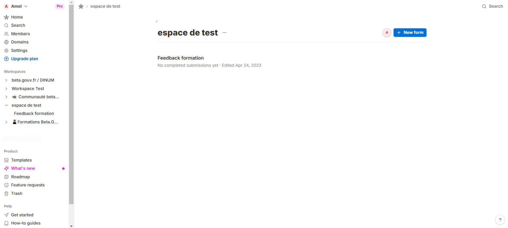

# Tally

​[Tally ](https://tally.so/)est un outil qui permet la création de formulaires et de sondages en ligne. Son utilisation est simple et peut s'adapter à toutes vos envies. \
\
Nous avons pris une licence afin de la partager avec les startups d'Etat souhaitant l'utiliser. Nous créons des espaces de travail pour chaque startup.

### 💡 Comment obtenir un accès à Tally ?

Rien de plus simple !

👉 Tu peux faire une demande en contactant [le support via le formulaire de contact](https://espace-membre.incubateur.net/support#contact) (bouton en bas à droite de la page)\
**ou** en écrivant directement à : [contact@beta.gouv.fr](mailto:contact@beta.gouv.fr)

💬 Si ta startup a déjà un compte Tally, un membre de ton équipe peut aussi t’ajouter directement. Pense à le ou la solliciter !


Pour des raisons de sécurité, une règle est à respecter : Seuls les mails d'agents publics ou les mails beta.gouv.fr sont autorisés à rejoindre les espaces de travail. Chaque compte ajouté ne respectant pas cette règle sera supprimé.


<figure><figcaption></figcaption></figure>
